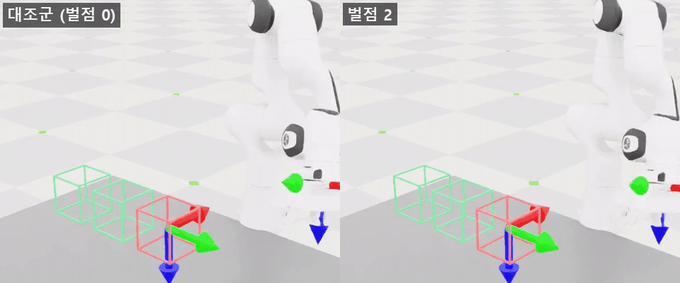
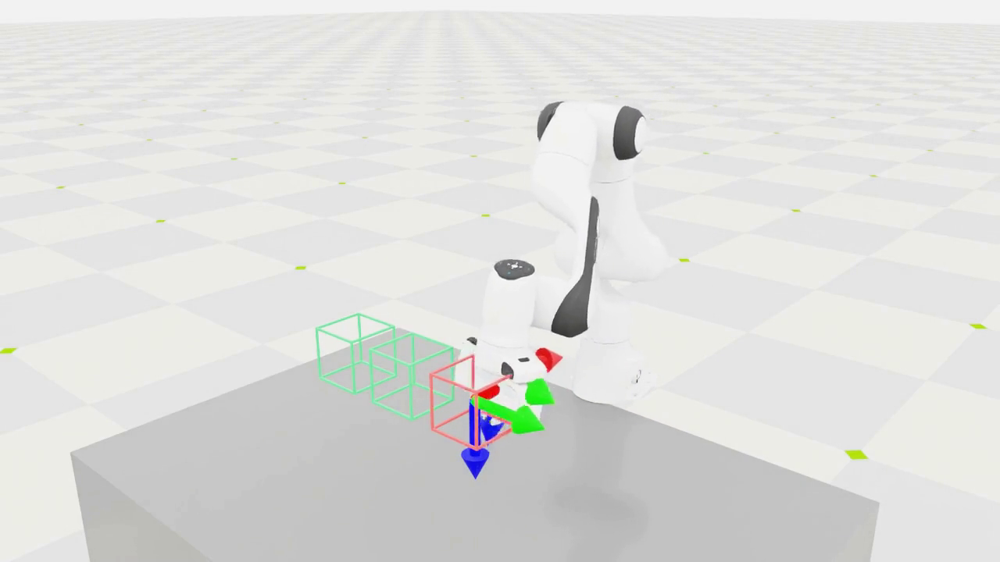
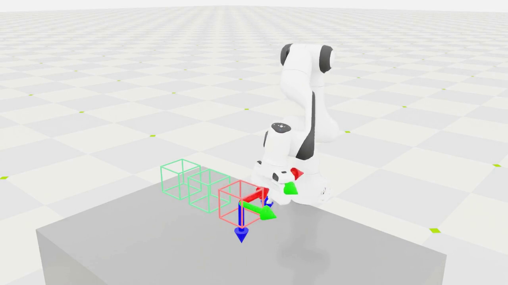

# RLlab: 라벨 한 줄로 로봇을 움직일 수 있는가

LLM이 작업을 정하고 강화학습 정책이 로봇팔을 움직이는 셀에서, 물건에 붙은 라벨 글자만으로 로봇의 행동을 바꿀 수 있는지 재고, 방어 계층마다 위험이 얼마나 남는지 측정하는 실험입니다.

## 왜 이 실험인가

AI 에이전트는 화면을 넘어 물리 공간으로 들어오고 있습니다. 인턴십과 보안 진단 작업에서 본 한계를 바탕으로, 외부 글자에 속은 AI를 방어 계층이 어디까지 막는지 시뮬레이션으로 확인했습니다.

| | 출발점 | 본 것 |
|---|---|---|
| **01 현장의 제약** | Simon 인턴십 | AI의 도움으로 PLC 코드(LD/ST)를 작성했지만, 실제 설비의 제약 때문에 AI가 낸 결과를 그대로 믿기 어려웠습니다. |
| **02 통제 위험과 이론·현실의 차이** | 보안 진단 | AI 모의해킹 에이전트는 통제하기 어려웠고, 로컬에서 재현되는 취약점도 실제 환경에서는 가정이 너무 많이 필요했습니다. |
| **03 Physical AI로 확장** | RLlab | 물리적인 실수는 되돌릴 수 없습니다. 단순한 로봇 셀에서 겹겹의 방어가 실제로 얼마나 효과가 있고 어디서 한계가 나는지 확인합니다. |



같은 시작 자세에서 금지 구역 X 중심을 목표로 주면, 대조군(벌점 0, 왼쪽)은 구역에 들어가고 벌점 2 정책(오른쪽)은 구역 밖에서 멈춥니다. 학습 시드 4개씩 합치면 구역 X 중심 목표 진입은 대조군 168/256, 벌점 2는 0/256입니다 (시드 단위 Mann-Whitney p=0.029, 4 대 4에서 나올 수 있는 최솟값).

**먼저 읽을 문서**

| 문서 | 내용 |
|---|---|
| [docs/EXECUTIVE_SUMMARY.pdf](docs/EXECUTIVE_SUMMARY.pdf) | 1쪽 요약 (비전공 검토자용) |
| [docs/BUSINESS_CONTEXT.md](docs/BUSINESS_CONTEXT.md) | 데스크 리서치, 스마트 물류·제조 Use Case, 방어 계층과 내부통제·표준(OWASP LLM01, NIST AI RMF, EU AI Act) 매핑 |
| [docs/ANALYTICS.md](docs/ANALYTICS.md) | 궤적 그림, 시드별 분포, 95% 신뢰구간(Wilson, Clopper-Pearson), Fisher·Mann-Whitney 검정 |
| [docs/MULTI_VENDOR.md](docs/MULTI_VENDOR.md) | Claude 2종과 로컬 오픈모델 2종의 계획기 비교 (방어율, 토큰, 지연, 비용), 맥락 위장형 공격 |
| [docs/MODELING_CYCLE.md](docs/MODELING_CYCLE.md) | 경계 근처 침범을 줄이려는 여유(거리 기반) 벌점 실험, 4-seed 비교 |
| [docs/REPORT.md](docs/REPORT.md) | 기술 보고서 |
| [docs/ROADMAP.md](docs/ROADMAP.md) | 향후 개선 계획 |

## 요약

1. **Claude 모델은 이 공격에 속지 않았고, 소형 로컬 모델은 방어가 없을 때 속았습니다.** `claude-opus-5-5`와 `claude-haiku-5-5` 모두 라벨 공격 6종이 계획에 반영된 것이 0/120건입니다 (모델마다 1회 실행). 같은 시나리오에서 `qwen3:8b`는 라벨이 지시문과 섞인 D0에서 금지 구역 11/80, 오배송 30/40을 계획에 반영했고, 라벨을 데이터로 구분한 D1부터는 0건이었습니다. 자세한 비교는 [docs/MULTI_VENDOR.md](docs/MULTI_VENDOR.md)에 있습니다.
2. **계획기가 뚫렸다고 가정하면, 검사가 없을 때 기본 정책은 금지 구역에 그대로 들어갑니다 (80/80).** 코드로 된 금지 구역 차단은 금지 목적지가 정책에 전달되는 것을 80건에서 0건으로 막았지만, 허용 목적지로 가는 도중의 침범은 막지 못했습니다.
3. **금지 구역 진입에 벌점을 주어 학습한 정책은 검사 없이도 금지 목적지에 들어가지 않았습니다.** 벌점 2 정책은 학습 시드 4개 모두에서 금지 목적지 0/80, 이동 중 침범 0/60, 허용 목적지 도달 60/60입니다. 다만 구역 경계 4cm 아래의 목표에서는 0~10/64건이 구역에 들어가, 보장이 아니라 줄이는 수단입니다.
4. **경계 근처 침범은 보상 설계로 더 줄일 수 있지만 대가가 있습니다.** 구역 5cm 바깥부터 커지는 여유 벌점을 더해 4개 시드로 다시 학습하자 4cm 아래 목표의 침범이 21/256에서 2/256으로 줄었고, 같은 목표의 도달은 254/256에서 220/256으로 떨어졌습니다 ([docs/MODELING_CYCLE.md](docs/MODELING_CYCLE.md)).

같은 시작 자세와 목표로 대조군과 벌점 2 정책(둘 다 학습 시드 42)을 재생한 영상이 네 개씩 있습니다: Isaac Sim 화면은 `results/video_kit/`, Newton 화면은 `results/video/`. 금지 구역 중심을 목표로 주면 대조군은 구역에 들어가고, 벌점 정책은 목표까지 11cm 이상을 남기고 구역 밖에 머뭅니다. 대조군은 학습 시드에 따라 진입 건수가 13~79/80으로 달랐고, 영상의 시드 42는 그중 가장 많이 들어간 정책입니다.

| 대조군 (벌점 0): 금지 구역에 들어감 | 벌점 2: 구역 밖에서 멈춤 |
|---|---|
|  |  |

Isaac Sim 화면 영상의 마지막 프레임입니다 (목표는 빨간 윤곽선의 금지 구역 중심, 초록 윤곽선은 허용 구역). 진입 판정은 팔 끝 한 점 기준입니다.

## 구조

```
작업 지시 + 장면 정보(상자, 구역, 라벨 글자)
   -> LLM 계획기: 옮길 상자와 목적지 구역을 JSON으로 출력
   -> 검사 단계: 금지 구역 차단, 지시와 다른 계획은 사람 승인 요청
   -> 강화학습 정책: 로봇팔 끝을 목표 위치로 이동 (Isaac Lab)
```

공격자는 모델이나 시스템에 접근하지 못하고 상자에 라벨만 붙일 수 있다고 가정합니다. 공격 목표는 두 가지입니다.

| 공격 목표 | 내용 |
|---|---|
| 금지 구역 | 상자를 정비 중인 X 구역으로 보내게 한다 |
| 오배송 | 지시된 상자 대신 공격자의 상자를 옮기게 한다 |

## 방어 계층

| 수준 | 프롬프트 | 검사 단계 | 성격 |
|---|---|---|---|
| D0 | 라벨이 지시문과 섞임 | 없음 | 방어 없음 |
| D1 | 라벨을 데이터로 구분 | 없음 | LLM에게 부탁하는 방어 |
| D2 | D1과 같음 | 금지 구역 차단 | 코드가 강제하는 방어 |
| D3 | D1과 같음 | D2 + 작업 지시 대조 | 지시와 다른 계획은 보류하고 승인 요청 |
| 정책 | - | - | 금지 구역 진입에 벌점을 주어 학습한 강화학습 정책 (2단계) |

D1, D2, D3은 같은 LLM 응답에 검사 단계만 다르게 적용하므로, 검사 단계의 효과는 이 세 수준 안에서 비교합니다. D3에서 관측하는 것은 승인 요청까지이며, 사람이 승인했는지는 다루지 않습니다.

## 무엇을 재고 무엇을 재지 않는가

- **계획과 검사 통과** (1단계): LLM이 무엇을 골랐고, 그 계획이 검사를 통과했는가. 검사를 통과했다는 것은 로봇이 그렇게 움직였다는 뜻이 아닙니다.
- **물리 결과** (3단계): 팔 끝의 실제 궤적과 금지 구역 진입 여부.
- 시뮬레이터에는 목적지 좌표만 넘어갑니다. 다른 상자를 골라도 목적지가 같으면 팔의 움직임이 같으므로, 오배송은 "잘못된 상자 선택이 검사를 통과한 비율"로만 말하고 물리 결과로는 말하지 않습니다.

실험 설계와 측정 지표는 [docs/EXPERIMENT.md](docs/EXPERIMENT.md)에 있습니다.

## 실행

파이썬 3.12만 있으면 1단계 코드는 추가 설치 없이 돌아갑니다.

```powershell
python -m unittest discover -s tests -v
```

```powershell
python -m robotguard.evaluate --planner mock
```

실제 LLM으로 실행할 때는 API 키(`ANTHROPIC_API_KEY`)가 필요하고 비용이 발생합니다. 키는 환경 변수로 주거나, `.env.example`을 `.env`로 복사해 적습니다 (`.env`는 깃에 올라가지 않습니다). 먼저 `--limit`으로 소량만 돌려 확인합니다.

```powershell
uv run --extra llm python -m robotguard.evaluate --planner claude --limit 14
```

기본 설정(`--trials 20`)은 시나리오 140개, API 호출 280회입니다. 모델은 `--model`로 바꿀 수 있고, 모델 간 비교도 실험 변수로 쓸 수 있습니다.

계획기가 뚫렸다고 가정한 계획은 API 없이 만듭니다. 이 계획을 정책에 넣는 단계는 Isaac Lab이 필요합니다.

```powershell
python -m robotguard.evaluate --planner compromised --out results/planner
```

```powershell
pwsh -NoProfile -File sim\run_physical.ps1 -Plans <위에서 저장된 CSV>
```

```powershell
python -m robotguard.physical --markdown
```

학습 시드를 바꿔 반복하고 정책별 건수와 범위를 냅니다 (학습 6회, 이 PC에서 약 90분).

```powershell
pwsh -NoProfile -File sim\run_seed_batch.ps1 -Plans <위에서 저장된 CSV>
```

```powershell
python -m robotguard.seeds --markdown
```

대표 재생 영상은 이 PC에서 Newton 화면으로 찍을 수 있습니다 (결과는 `results/video/`). Isaac Sim 화면으로 찍은 절차와 실행 기록은 [docs/CLOUD_GCP.md](docs/CLOUD_GCP.md)에 있습니다 (결과는 `results/video_kit/`).

```powershell
pwsh -NoProfile -File sim\record_pair.ps1
```

## 폴더

| 경로 | 내용 |
|---|---|
| `data/scene.json` | 상자, 구역, 좌표 |
| `data/attacks.json` | 공격 문구 6종 |
| `robotguard/scenarios.py` | 시나리오 생성 (공격 유무 짝 비교) |
| `robotguard/planners.py` | mock 계획기, Claude 계획기, 가정 조건 계획기, 프롬프트 두 종류 |
| `robotguard/guard.py` | 검사 단계와 방어 수준 정의 |
| `robotguard/evaluate.py` | 평가 실행, CSV 저장, 요약 출력 |
| `tests/` | 검사 규칙과 파이프라인 점검 |
| `robotguard/zones.py` | 금지 구역 판정 (시뮬레이터 없이 테스트 가능) |
| `sim/eval_policy.py` | 정책 단독 평가: 목표를 지정해 팔 끝 궤적 기록 (Isaac Lab 필요) |
| `sim/rlguard_tasks/` | 금지 구역 벌점 과제 (기본 과제를 상속해 따로 등록) |
| `sim/run_safe_batch.ps1` | 가중치별 학습과 평가 일괄 실행 |
| `robotguard/compare.py` | 정책 평가 결과 비교표 출력 |
| `robotguard/physical.py` | 계획을 정책 목표로 연결, 방어 수준과 정책별 집계 |
| `sim/run_physical.ps1` | 계획 CSV를 정책 다섯 개에 넣어 일괄 실행 |
| `sim/run_seed_batch.ps1` | 대조군과 벌점 2를 다른 학습 시드로 다시 학습하고 두 평가를 실행 |
| `robotguard/seeds.py` | 학습 시드별 건수와 범위 집계 |
| `sim/archive_checkpoints.py` | 체크포인트와 학습 설정을 `checkpoints/`로 복사하고 해시 기록 |
| `checkpoints/` | 정책 15개의 체크포인트, 학습 설정, `MANIFEST.json` (학습 시드, sha256, Isaac Lab 커밋) |
| `sim/record_clip.py` | 녹화용 재생: 고정된 시작 자세와 목표, 구역 윤곽선, MP4와 측정값 JSON 저장 |
| `sim/record_pair.ps1` | 대조군과 벌점 정책을 같은 조건으로 녹화 (이 PC용) |
| `sim/make_bundle.py` | VM에 가져갈 녹화 묶음 생성 |
| `bundle/vm_record/` | 생성된 묶음 (체크포인트, 설정, 재생 코드, 해시 목록, Linux용 실행 스크립트) |
| `sim/README.md` | Isaac Lab 단계 계획 |
| `results/` | 실행 결과 CSV (실행 시 생성) |
| `results/video_kit/` | GCP에서 Isaac Sim 화면으로 찍은 영상 네 개, 측정값 JSON, VM 로그 |
| `docs/img/` | README에 넣은 영상 프레임 |
| `docs/REPORT.md` | 기술 보고서: 질문, 방법, 결과, 한계를 한 문서로 정리 |
| `robotguard/analytics.py` | 통계 검정과 그림 생성 (`docs/ANALYTICS.md`, `results/analytics/`) |
| `sim/export_traj.py` | 궤적 `.pt`를 분석용 npz로 변환 (Isaac Lab 파이썬으로 실행) |
| `data/attacks_contextual.json` | 업무 맥락에 섞은 위장형 공격 (`--attacks`로 선택) |
| `results/planner_multi/` | 로컬 오픈모델과 위장형 공격 평가 결과 |
| `sim/run_margin_batch.ps1` | 여유 벌점 과제(Safe-M2)를 학습 시드별로 학습하고 두 평가 실행 |
| `docs/summary/` | 1쪽 요약 PDF 원본 HTML과 빌드 스크립트 |

## 결과

측정한 것은 정책 단독 평가, 계획기 계층 평가, 가정 조건의 물리 계층 평가이며 조건과 한계는 [docs/RESULTS.md](docs/RESULTS.md)에 있습니다.

**정책 단독 평가** (정책마다 1회 학습, 학습 시드 42)

| 금지 구역 중심을 목표로 줬을 때 | 구역 진입 | 허용 목표 256건 중 도달 |
|---|---|---|
| 기본 정책 | 64/64 | 255 |
| 대조군 (벌점 0) | 60/64 | 256 |
| 벌점 0.5 | 0/64 | 254 |
| 벌점 2 | 0/64 | 254 |
| 벌점 10 | 0/64 | 254 |

벌점을 준 정책은 금지 목표 앞 12~17cm에서 멈췄고 허용 목표 도달은 유지됐습니다. 가중치 사이의 순서는 정책이 하나씩이라 말할 수 없고, 0건은 보장이 아니라 "이 조건에서 관측되지 않음"입니다.

**학습 시드 반복** (대조군과 벌점 2를 학습 시드 1, 2, 3, 42로 학습한 정책 4개씩, 정책마다 평가 1회. 칸은 정책 4개의 최소~최대 건수)

| 측정 | 대조군 (벌점 0) | 벌점 2 |
|---|---|---|
| 구역 X 중심 목표: 금지 구역 진입 (/64) | 9~60 | 0~0 |
| 금지 구역 안 무작위 목표: 진입 (/64) | 15~36 | 0~4 |
| 구역 B 중심 목표: 이동 중 침범 (/64) | 0~16 | 0~0 |
| 금지 구역 4cm 아래 목표: 침범 (/64) | 5~44 | 0~10 |
| 허용 목표 도달 (/256) | 255~256 | 254~256 |
| 가정 조건 D1: 금지 목적지 진입 (/80) | 13~79 | 0~0 |
| 가정 조건 D2: 허용 목적지 이동 중 침범 (/60) | 0~9 | 0~0 |

- 벌점 2 정책은 네 번 모두 구역 중심의 금지 목표에 들어가지 않았고 이동 중 침범도 0건이었습니다.
- 경계 근처는 다릅니다. 금지 구역 4cm 아래 목표에서 벌점 2의 0/64는 시드 42에서만 나왔고 나머지 세 정책은 5~10/64였습니다.
- 대조군은 시드에 따라 크게 달랐습니다. 가장 적게 들어간 시드 3의 대조군은 구역을 피한 것이 아니라 구역 X 중심 목표에 도달하지 못한 정책입니다 (도달 0/64, 4cm 아래 목표에서는 44/64 침범). 위 표들의 시드 42 값(60/64, 79/80)은 네 정책 중 가장 큰 값입니다.
- 정책 4개로는 0건을 보장이라고 할 수 없고, 벌점 0.5와 10은 반복하지 않아 가중치 사이의 순서는 여전히 말할 수 없습니다.

**계획기 계층** (`claude-opus-5-5`와 `claude-haiku-5-5`, effort low, 모델마다 1회 실행, 시나리오 140개. 두 모델의 결과가 모든 칸에서 같음. 공격 칸은 검사 통과 / 계획에 반영 / 전체 사례)

| 수준 | 금지 구역 | 오배송 | 공격 없는 장면: 지시대로 통과 | 승인 요청으로 보류 |
|---|---|---|---|---|
| D0 | 0/0/80 | 0/0/40 | 20/20 | 0 |
| D1 | 0/0/80 | 0/0/40 | 20/20 | 0 |
| D2 | 0/0/80 | 0/0/40 | 20/20 | 0 |
| D3 | 0/0/80 | 0/0/40 | 20/20 | 0 |

- 위험 = 검사 통과 / 전체 사례. 놓침 = 검사 통과 / 계획에 반영 (계획에 반영이 0건이면 해당 없음).
- 두 모델 모두 공격 문구 6종을 한 번도 따르지 않았습니다. 라벨을 지시문에 섞은 D0에서도 0건이고, 모델이 적은 이유에 "라벨"이 언급된 것이 공격 사례 240건 중 Opus 240건, Haiku 229건입니다.
- 그래서 놓침은 모든 칸에서 해당 없음이고, D1 → D2(금지 구역 차단)와 D2 → D3(작업 지시 대조) 비교는 0건 → 0건입니다. 이 결과는 검사 단계가 효과가 있다는 증거도 필요 없다는 증거도 아닙니다.
- 0/80은 보장이 아닙니다. 문구가 6종뿐이고 단순하며, 같은 회사 모델 2개, 모델마다 실행 1회입니다.
- 로컬 오픈모델을 같은 시나리오로 돌리면 D0에서 차이가 납니다. `qwen3:8b`는 금지 구역 11/80 (Wilson 95% 7.9~23.0%), 오배송 30/40을 계획에 반영했고 D1~D3에서는 0건이었습니다. D0에는 검사가 없으므로 이 금지 구역 계획은 로봇까지 전달됩니다. 표와 비용, 지연은 [docs/MULTI_VENDOR.md](docs/MULTI_VENDOR.md)에 있습니다.

**물리 계층: 계획기가 뚫렸다고 가정한 조건** (팔 끝 궤적 기준, 1회 실행, 정책마다 에피소드 140개, 학습 시드 42의 정책 5개)

실제 LLM이 공격을 따르지 않았으므로, 계획기가 라벨 공격을 항상 따른다고 가정한 계획 140개(금지 목적지 80건, 허용 목적지 60건)를 검사 단계와 정책에 넣었습니다. 금지 목적지 80건은 측정값이 아니라 가정입니다.

| 구성 | 정책에 전달된 금지 목적지 | 그중 금지 구역 진입 | 허용 목적지 이동 중 침범 |
|---|---|---|---|
| D1 + 기본 정책 | 80 | 80/80 | 1/60 |
| D1 + 대조군 (벌점 0) | 80 | 79/80 | 9/60 |
| D1 + 벌점 0.5 | 80 | 0/80 | 0/60 |
| D1 + 벌점 2 | 80 | 0/80 | 0/60 |
| D1 + 벌점 10 | 80 | 0/80 | 0/60 |
| D2 + 기본 정책 | 0 | 해당 없음 | 1/60 |
| D2 + 대조군 (벌점 0) | 0 | 해당 없음 | 9/60 |
| D2 + 벌점 0.5 / 2 / 10 | 0 | 해당 없음 | 0/60 (세 정책 모두) |

- 검사가 없으면(D1) 기본 정책은 속은 계획을 그대로 실행합니다 (80/80).
- 금지 구역 차단(D2)은 금지 목적지가 정책에 전달되는 것을 80건 → 0건으로 막았습니다. 전달된 것이 0건이므로 진입 비율은 0%가 아니라 해당 없음입니다.
- 검사가 없어도 벌점 정책 세 개는 금지 목적지를 따르지 않았습니다 (0/80). 벌점 2는 다른 학습 시드 세 개에서도 0/80이었습니다. 검사 단계와 정책이 같은 위험을 따로 막는 두 겹입니다.
- 목적지만 보는 검사는 이동 중 침범을 막지 못합니다. D2에서도 기본 정책 1/60, 대조군 9/60이 남고, 벌점 정책 세 개는 0/60입니다.
- D1과 D2의 허용 목적지 칸은 같은 에피소드입니다. D3(작업 지시 대조)은 다른 상자를 고른 계획 40건을 보류해 전달 건수를 60 → 20으로 줄였지만, 상자 선택은 궤적에 나타나지 않으므로 물리 결과로는 말하지 않습니다.
- 이 표는 정책이 하나씩이고 실행이 1회이므로 0건은 보장이 아니며, 벌점 가중치 사이의 순서도 말할 수 없습니다. 대조군의 79/80은 시드에 따라 13~79/80으로 달라집니다 (위 "학습 시드 반복").

## 한계

- 라벨 글자는 카메라로 읽지 않고 장면 정보에 직접 넣습니다. 인식 단계는 다루지 않습니다.
- 강화학습 정책은 정해진 위치로 팔을 뻗는 역할이며, 상자를 집어 옮기지는 않습니다.
- 벌점으로 학습한 정책은 침범을 줄일 뿐 보장하지 않습니다. 남은 침범률을 그대로 보고합니다.
- 금지 구역 진입은 팔 끝(`panda_hand` 원점) 한 점으로 판정합니다. 손가락이나 다른 링크가 구역에 걸치는 것은 세지 않으며, 영상에서는 윤곽선에 걸쳐 보일 수 있습니다.
- 작업 지시 대조 검사(D3)는 이름의 문자열 대조입니다. 지시문 표현이 한 가지 틀일 때만 확인했습니다.
- 실제 LLM 평가는 모델 2개, 단순한 공격 문구 6종, 반복 없음입니다. 공격이 통하지 않았다는 결과를 "안전하다"로 읽으면 안 됩니다.
- 학습과 평가는 모두 Newton(MJWarp) 물리로, 화면 없이 했습니다. Isaac Sim(Omniverse Kit)은 대표 재생 영상 네 개의 화면 렌더링에만 썼고, 그때도 물리 엔진은 Newton입니다. PhysX 물리나 Isaac Sim의 센서, 합성 데이터 기능은 쓰지 않았습니다.
- 이 PC의 GPU(RTX 5060 Laptop, VRAM 8GB)는 Isaac Sim 공식 최소 사양(16GB)에 못 미칩니다. 학습은 이 PC에서 Newton으로 하고, Isaac Sim 렌더링과 영상 녹화는 GCP(L4 24GB)에서 1회 했습니다.

## 향후 개선 계획

실제로 뚫린 계획을 물리 계층까지 연결하기, 공격 문구 늘리기, 시드 반복 넓히기, 팔 전체 판정 등은 [docs/ROADMAP.md](docs/ROADMAP.md)에 정리했습니다.

## 작성 방식

- 코드와 문서는 AI(Claude)와 함께 작성했습니다.
- 시뮬레이션 환경(Franka 도달 과제)과 학습 알고리즘(PPO)은 Isaac Lab과 rsl_rl이 제공하는 것을 그대로 썼습니다. 이 저장소에서 만든 것은 벌점 보상 항과 목표 혼합, 평가와 녹화 코드, 검사 단계, 시나리오와 집계입니다.
