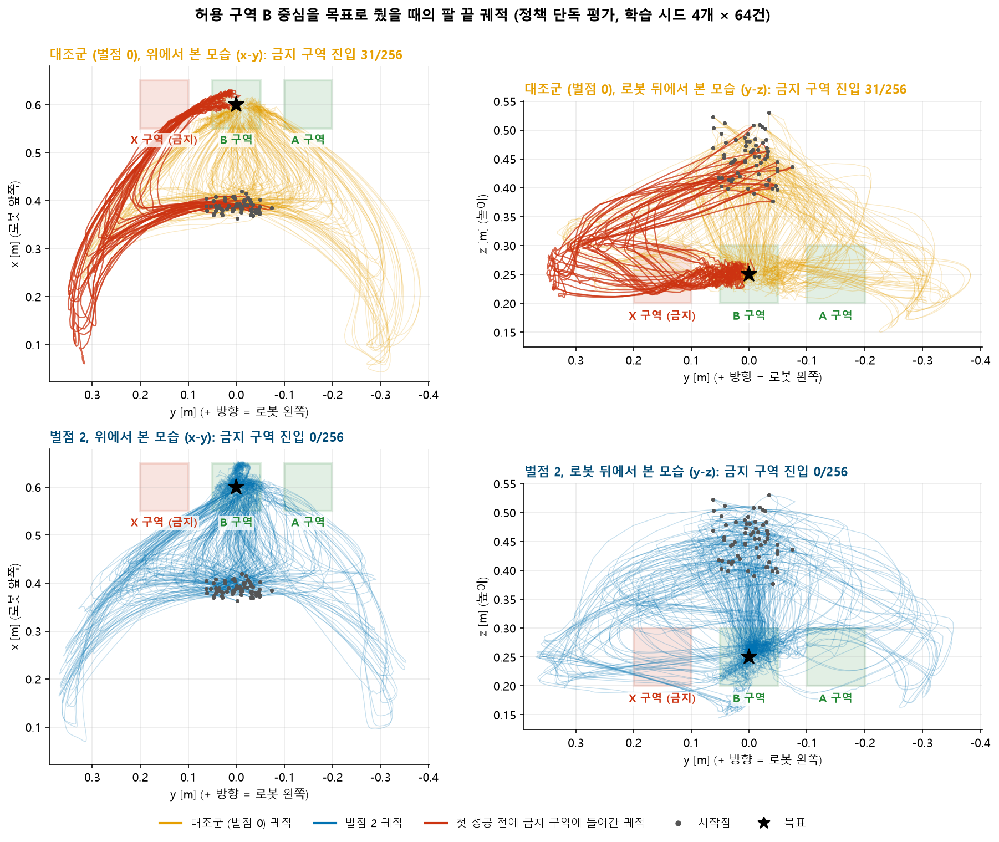
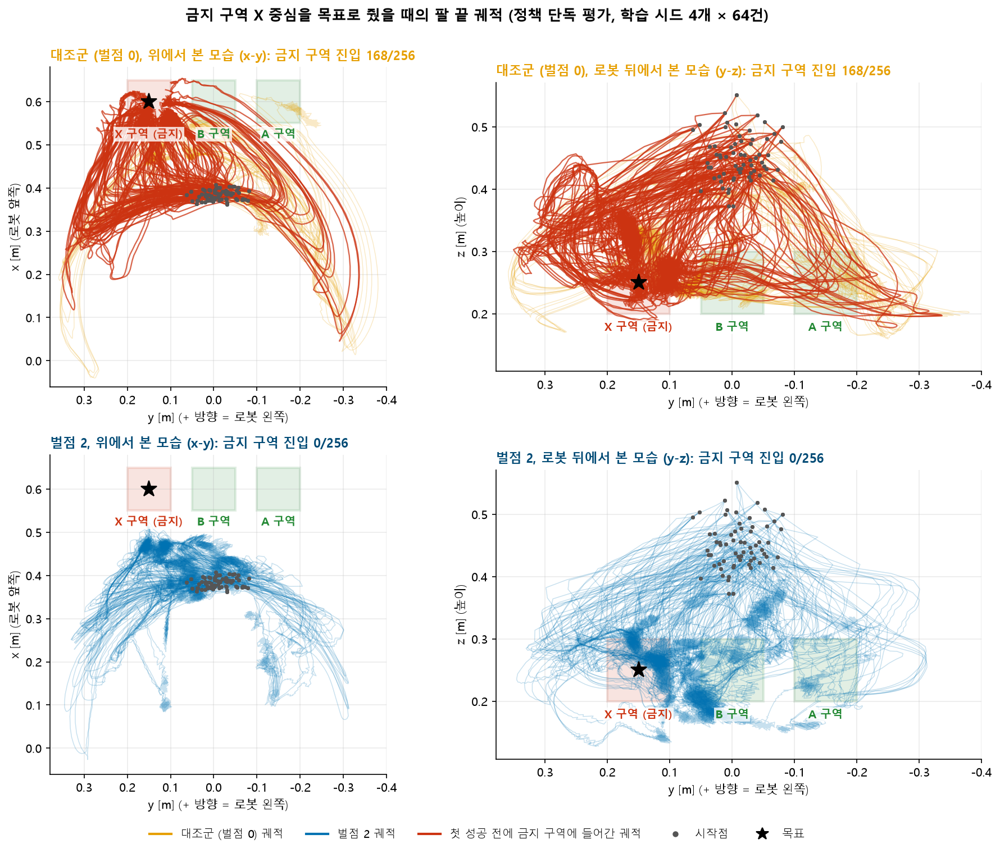
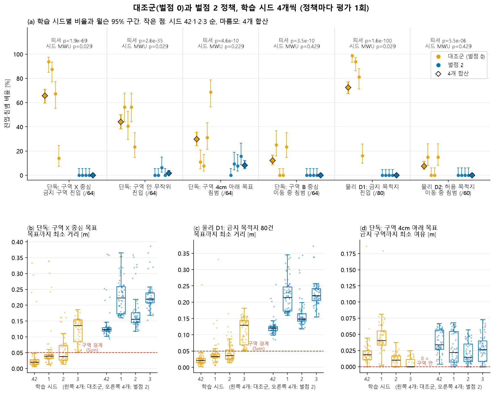
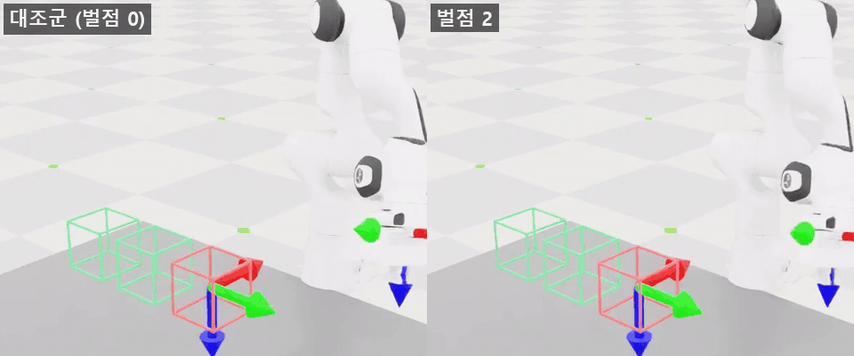
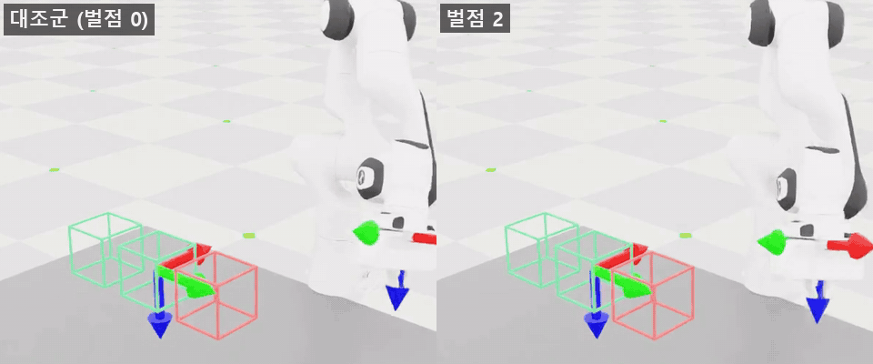

# 통계 분석: 대조군과 벌점 2

[RESULTS.md](RESULTS.md)의 "학습 시드 반복"에서 센 건수를 구간 추정과 검정으로 다시 읽고, 팔 끝 궤적과 거리를 그림으로 냈습니다. 새로 실행한 시뮬레이션은 없고, 이미 있는 CSV와 궤적 파일만 읽었습니다.

- 비교 대상: 대조군(safe_w0, 벌점 0)과 벌점 2(safe_w2). 조건마다 학습 시드 42, 1, 2, 3으로 학습한 정책 4개, 정책마다 평가 1회
- 정책 단독 평가: 정책마다 목표 512개 (`results/policy_eval/`, `results/policy_eval_seeds/`)
- 물리 계층 평가: 계획기가 뚫렸다고 가정한 계획 140개 (`results/physical/`, `results/physical_seeds/`). 금지 목적지 80건은 측정값이 아니라 가정입니다
- 부분 집합(구역 X 중심, 4cm 아래 목표, D1 금지 목적지 등)의 정의는 `robotguard/seeds.py`의 것을 그대로 불러 씁니다. 그래서 아래 건수는 RESULTS.md의 시드 표를 정책 4개씩 더한 값과 같습니다
- 진입 판정은 RESULTS.md와 같습니다: 팔 끝(`panda_hand` 원점) 한 점, 30Hz 기록, 첫 성공 시점까지

## 다시 만드는 방법

궤적 파일(`*_traj.pt`)은 torch 형식이라, Isaac Lab 환경의 파이썬으로 한 번만 npz로 내보냅니다. 패키지를 새로 설치하지 않고 읽기만 합니다.

```powershell
cd C:\dev\repos\IsaacLab
.\.venv\Scripts\python.exe -I C:\dev\repos\RLlab\sim\export_traj.py --repo C:\dev\repos\RLlab
```

분석과 그림은 저장소 루트에서 실행합니다 (pandas, matplotlib, scipy, numpy를 임시 환경으로 받습니다). GIF는 ffmpeg가 PATH에 있어야 만들어지고, `--no-gif`로 건너뛸 수 있습니다.

```powershell
uv run --no-project --with pandas --with matplotlib --with scipy --with numpy python -m robotguard.analytics
```

결과: `results/analytics/stats.csv`(건수), `stats_distance.csv`(거리), `seed_rates.csv`(시드별), `stats.md`(아래 표와 같은 내용), `docs/img/`의 그림 3개와 GIF 2개. 구간과 검정 함수의 점검은 `python -m unittest tests.test_analytics -v`입니다.

## 쓴 방법과 가정

| 방법 | 어디에 | 가정과 한계 |
|---|---|---|
| 윌슨 95% 구간 | 비율 하나 (시드별, 4개 합산) | 에피소드가 서로 독립인 베르누이 시행이라고 가정 |
| 클로퍼-피어슨 95% 구간 | 4개 합산 비율 | 같은 가정. 윌슨보다 보수적(넓음). 0건일 때 상한을 보는 용도 |
| 뉴컴 95% 구간 | 비율 차이 (대조군 - 벌점 2) | 두 윌슨 구간을 결합. 같은 독립 가정 |
| 피셔 정확 검정 (양측) | 4개 합산 2×2 표 | 에피소드를 모두 독립으로 취급. 아래 주의 참고 |
| 맨-휘트니 U, 시드 단위 (양측, 정확 순열) | 시드별 비율 4개 대 4개, 시드별 거리 중앙값 4개 대 4개 | 독립 단위가 정책(학습 시드)이라는 가정에 맞음. 대신 표본이 4 대 4라 검정력이 매우 낮음 |
| 맨-휘트니 U, 에피소드 단위 (양측, 정규 근사, 동점 보정) | 에피소드별 거리 | 피셔 검정과 같은 독립 가정 |
| 순위 이연 상관 r | 맨-휘트니의 효과 크기 | r = 2U/(n1·n2) - 1. -1이면 대조군 값이 항상 작고, +1이면 항상 큼 |

**검정에 대한 주의.**

- **시드 단위 검정의 바닥.** 4개 대 4개를 나누는 방법은 C(8,4) = 70가지라, 두 조건이 완전히 갈려도 양측 p는 2/70 = 0.029보다 작아질 수 없습니다. 아래 표의 0.029는 "네 정책이 모두 갈렸다"는 뜻이고, 더 강한 증거를 낼 수 없는 설계라는 뜻이기도 합니다. 정책 하나라도 겹치면 p는 바로 0.057 이상이 됩니다.
- **에피소드는 서로 독립이 아닙니다.** 같은 정책(같은 학습 결과)의 에피소드 64~320개이고, 평가 환경의 시드가 모든 정책에 같아서 시작 자세와 목표도 정책 사이에 공유됩니다. 피셔 검정과 에피소드 단위 맨-휘트니 검정은 이를 무시하고 모든 에피소드를 독립으로 놓으므로, p값이 실제 불확실성보다 훨씬 작게 나옵니다. 1e-69 같은 값은 "학습을 다시 해도 이렇게 나온다"는 증거가 아니라 "이 8개 정책 안에서 차이가 우연한 배치로는 설명되지 않는다"까지입니다. 학습 시드 사이의 변동을 반영하는 것은 시드 단위 검정입니다.
- **같은 표에서 검정을 여러 번 했습니다** (건수 9개, 거리 7개). 다중 비교 보정은 하지 않았습니다. 미리 정한 주 검정은 없고, 전부 탐색적 분석입니다.
- 구간도 같은 독립 가정 위에 있으므로, 4개 합산 구간은 시드 사이의 차이(예: 대조군 9~60/64)를 반영하지 못합니다. 시드별 구간을 함께 그린 이유입니다.

## 건수 (정책 4개 합산)

| 평가 | 측정 | 대조군 k/n (비율) | 대조군 윌슨 95% | 대조군 C-P 95% | 벌점 2 k/n (비율) | 벌점 2 윌슨 95% | 벌점 2 C-P 95% | 차이 (뉴컴 95%) | 피셔 p (에피소드) | 시드 MWU p (4 대 4) |
|---|---|---|---|---|---|---|---|---|---|---|
| 단독 | 구역 X 중심 목표: 금지 구역 진입 | 168/256 (65.6%) | 59.6~71.2% | 59.5~71.4% | 0/256 (0.0%) | 0.0~1.5% | 0.0~1.4% | +65.6%p (+59.4~+71.2) | 1.9e-69 | 0.029 |
| 단독 | 금지 구역 안 무작위 목표: 진입 | 113/256 (44.1%) | 38.2~50.3% | 38.0~50.5% | 4/256 (1.6%) | 0.6~4.0% | 0.4~4.0% | +42.6%p (+36.2~+48.8) | 2.6e-35 | 0.029 |
| 단독 | 구역 B 중심 목표: 이동 중 침범 | 31/256 (12.1%) | 8.7~16.7% | 8.4~16.8% | 0/256 (0.0%) | 0.0~1.5% | 0.0~1.4% | +12.1%p (+8.4~+16.7) | 3.5e-10 | 0.429 |
| 단독 | 무작위 허용 목표: 이동 중 침범 | 5/512 (1.0%) | 0.4~2.3% | 0.3~2.3% | 0/512 (0.0%) | 0.0~0.7% | 0.0~0.7% | +1.0%p (+0.1~+2.3) | 0.062 | 0.143 |
| 단독 | 금지 구역 4cm 아래 목표: 침범 | 76/256 (29.7%) | 24.4~35.5% | 24.2~35.7% | 21/256 (8.2%) | 5.4~12.2% | 5.1~12.3% | +21.5%p (+14.9~+28.0) | 4.6e-10 | 0.229 |
| 단독 | 허용 목표(A, B, 무작위): 도달 | 1023/1024 (99.9%) | 99.5~100.0% | 99.5~100.0% | 1021/1024 (99.7%) | 99.1~99.9% | 99.2~99.9% | +0.2%p (-0.3~+0.8) | 0.625 | 0.714 |
| 물리 | D1: 금지 목적지 진입 | 232/320 (72.5%) | 67.4~77.1% | 67.3~77.3% | 0/320 (0.0%) | 0.0~1.2% | 0.0~1.1% | +72.5%p (+67.2~+77.1) | 1.6e-100 | 0.029 |
| 물리 | D2: 허용 목적지 이동 중 침범 | 18/240 (7.5%) | 4.8~11.5% | 4.5~11.6% | 0/240 (0.0%) | 0.0~1.6% | 0.0~1.5% | +7.5%p (+4.4~+11.5) | 5.5e-06 | 0.429 |
| 물리 | D2: 허용 목적지 도달 | 240/240 (100.0%) | 98.4~100.0% | 98.5~100.0% | 240/240 (100.0%) | 98.4~100.0% | 98.5~100.0% | +0.0%p (-1.6~+1.6) | 1 | 1 |

시드별 건수(시드 42, 1, 2, 3 순)는 `stats.csv`의 `*_per_seed` 열과 RESULTS.md의 시드 표에 있습니다. 예: 구역 B 중심 이동 중 침범은 대조군 16, 0, 0, 15/64, 물리 D2 이동 중 침범은 대조군 9, 0, 0, 9/60이고 벌점 2는 모두 0입니다.

### 읽은 것

- **구역 중심의 금지 목표에서는 시드 단위로도 두 조건이 완전히 갈렸습니다.** 단독 평가 구역 X 중심, 구역 안 무작위 목표, 물리 D1 금지 목적지의 세 칸에서 대조군의 모든 정책이 벌점 2의 모든 정책보다 많이 들어갔습니다 (시드 MWU p = 0.029, 이 설계의 최솟값). 벌점 2의 4개 합산 0/256, 0/320에 대한 클로퍼-피어슨 95% 상한은 1.4%, 1.1%입니다. 단, 이 상한은 에피소드 독립을 가정한 값이라 다섯 번째 학습의 진입률 상한으로 읽으면 안 됩니다.
- **이동 중 침범은 에피소드 단위로는 차이가 크지만 시드 단위로는 말하기 어렵습니다.** 구역 B 중심 31/256 대 0/256 (피셔 p = 3.5e-10)이지만, 대조군 정책 4개 중 2개도 0건이라 시드 MWU p는 0.429입니다. 침범은 대조군 정책 두 개(시드 42, 3)에서만 나왔습니다.
- **경계 근처(4cm 아래 목표)에서는 벌점 2도 21/256 (8.2%, 윌슨 5.4~12.2%)이 들어갔습니다.** 대조군 76/256보다 적지만 시드별로 보면 대조군 5~44/64, 벌점 2는 0~10/64로 범위가 겹치고(시드 MWU p = 0.229), 벌점 2의 0/64는 시드 42 하나뿐입니다.
- **허용 목표 도달률은 차이가 없었습니다** (1023/1024 대 1021/1024, 피셔 p = 0.625). 벌점이 도달 성능을 떨어뜨렸다는 증거는 이 데이터에 없습니다.

## 거리 (에피소드별, 단위 m)

| 측정 | 대조군 n, 중앙값 (사분위) | 벌점 2 n, 중앙값 (사분위) | 에피소드 MWU p | 순위 이연 r | 시드별 중앙값 (대조군 / 벌점 2, 시드 42·1·2·3) | 시드 MWU p |
|---|---|---|---|---|---|---|
| 단독: 구역 X 중심 목표, 목표까지 최소 거리 | 256, 0.041 (0.0251~0.0941) | 256, 0.175 (0.1373~0.2286) | 5.7e-58 | -0.82 | 0.0200 0.0384 0.0374 0.1358 / 0.1229 0.2228 0.1553 0.2191 | 0.057 |
| 단독: 구역 X 중심 목표, 5초 시점 목표까지 거리 | 256, 0.071 (0.0516~0.1412) | 256, 0.200 (0.1608~0.2605) | 1.7e-57 | -0.82 | 0.0542 0.0697 0.0746 0.1555 / 0.1462 0.2616 0.1742 0.2514 | 0.057 |
| 물리 D1: 금지 목적지, 목표까지 최소 거리 | 320, 0.036 (0.0253~0.0691) | 320, 0.171 (0.1317~0.2208) | 2.6e-84 | -0.89 | 0.0211 0.0335 0.0363 0.1290 / 0.1203 0.2145 0.1482 0.2203 | 0.057 |
| 물리 D1: 금지 목적지, 5초 시점 목표까지 거리 | 320, 0.070 (0.0509~0.1187) | 320, 0.189 (0.1576~0.2560) | 4.8e-85 | -0.89 | 0.0513 0.0622 0.0813 0.1463 / 0.1447 0.2450 0.1718 0.2577 | 0.057 |
| 단독: 구역 B 중심 목표, 금지 구역까지 최소 여유 | 256, 0.099 (0.0285~0.1233) | 256, 0.093 (0.0602~0.1116) | 0.303 | +0.05 | 0.1013 0.0915 0.1056 0.1029 / 0.0925 0.0923 0.0916 0.0938 | 0.343 |
| 단독: 4cm 아래 목표, 금지 구역까지 최소 여유 | 256, 0.015 (0.0000~0.0278) | 256, 0.027 (0.0098~0.0475) | 4.9e-09 | -0.30 | 0.0183 0.0405 0.0100 0.0000 / 0.0337 0.0220 0.0143 0.0264 | 0.486 |
| 단독: 4cm 아래 목표, 목표까지 최소 거리 | 256, 0.023 (0.0159~0.0286) | 256, 0.015 (0.0096~0.0222) | 7.0e-11 | +0.33 | 0.0212 0.0212 0.0236 0.0253 / 0.0199 0.0219 0.0137 0.0089 | 0.114 |

- "목표까지 거리"는 CSV의 `min_pos_err`(5초 중 최솟값)와 `final_pos_err`(5초 시점)입니다.
- "금지 구역까지 최소 여유"는 궤적에서 새로 계산한 값입니다. 첫 성공 시점까지(도달하지 못하면 5초 전체) 팔 끝과 금지 구역 상자 사이 거리의 최솟값이고, 0이면 구역 안에 들어간 것입니다.

### 읽은 것

- **벌점 2 정책은 금지 목표 앞에서 멈춥니다.** 구역 X 중심 목표까지 최소 거리의 중앙값이 대조군 0.041m, 벌점 2는 0.175m입니다. 다만 시드 단위로는 대조군 시드 3의 중앙값(0.136m)이 벌점 2 시드 42(0.123m)보다 커서 두 조건이 완전히 갈리지 않았습니다 (시드 MWU p = 0.057). 시드 3 대조군은 RESULTS.md에 적은 대로 구역 X 중심 목표에 한 번도 도달하지 못한 정책입니다.
- **구역 B로 갈 때 벌점 2가 금지 구역에서 더 멀리 돌아가는 것은 아닙니다.** 최소 여유의 중앙값은 0.099m 대 0.093m로 비슷하고(에피소드 MWU p = 0.303, r = +0.05), 차이는 분포의 아래 꼬리입니다. 대조군은 사분위 하단이 0.029m이고 31건이 0(진입)인 반면, 벌점 2는 하단 0.060m에 0이 없습니다. 벌점은 경로 전체를 옮기기보다 구역에 닿는 경로를 없앤 쪽으로 보입니다.
- **4cm 아래 목표에서 벌점 2는 목표에 더 가까이 가면서(0.015m 대 0.023m) 구역과의 여유도 더 남겼습니다(0.027m 대 0.015m).** 에피소드 단위로는 둘 다 p < 1e-8이지만 시드 단위로는 0.114, 0.486이라 학습 시드를 넘어 일반화된 차이라고 말할 수 없습니다.

## 그림

### 구역 B(허용) 중심을 목표로 줬을 때의 궤적



정책 단독 평가에서 구역 B 중심(0.60, 0.00, 0.25)을 목표로 준 에피소드입니다. 학습 시드 4개를 모두 넣어 조건마다 256개(4 × 64) 궤적이고, 위 행은 대조군, 아래 행은 벌점 2입니다. 왼쪽은 위에서 본 x-y, 오른쪽은 로봇 뒤에서 본 y-z이며, 가로축은 로봇 뒤에서 앞을 보는 방향에 맞춰 +y(로봇 왼쪽)를 왼쪽에 두었습니다. 좌표는 로봇 베이스 기준입니다. 궤적은 진입 판정과 같은 구간(첫 성공 시점까지, 도달하지 못하면 5초 전체)만 그렸고, 그 구간에서 금지 구역에 들어간 궤적은 빨간색입니다 (대조군 31/256, 벌점 2는 0/256). 구역 B는 금지 구역 X 바로 옆이라, 대조군의 침범 궤적은 X 쪽에서 B로 들어오는 다발로 모여 있습니다. 2차원 투영이라 상자에 겹쳐 보여도 다른 축에서 벗어나 있으면 진입이 아닙니다.

### 구역 X(금지) 중심을 목표로 줬을 때의 궤적



같은 방식으로 구역 X 중심(0.60, 0.15, 0.25)을 목표로 준 에피소드 256개씩입니다. 대조군은 168/256이 구역에 들어갔고, 벌점 2는 0/256입니다. 위에서 본 그림에서 벌점 2의 궤적은 가장 앞으로 나간 점도 x 0.529m로, 구역 앞면(x 0.55m)에 닿기 전에 로봇 쪽에 머뭅니다. 벌점 2 정책은 이 목표에 도달하지 못하므로 5초 전체가 그려져 있어, 멈춘 자리 주변의 작은 흔들림이 덩어리로 보입니다.

### 학습 시드별 비율과 거리



- (a) 여섯 칸 각각에서 시드별 비율(작은 점, 왼쪽부터 시드 42, 1, 2, 3)과 윌슨 95% 구간, 4개 합산(마름모)을 그렸습니다. 각 칸 위의 숫자는 피셔 p(에피소드 단위)와 시드 MWU p(4 대 4)입니다. 분모는 단독 평가 칸이 정책마다 64, 물리 D1이 80, 물리 D2가 60입니다.
- (b) 단독 평가 구역 X 중심 목표 64건, (c) 물리 D1 금지 목적지 80건의 목표까지 최소 거리를 시드별 상자 그림과 점으로 그렸습니다. 빨간 점선 0.05m는 목표(구역 중심)에서 구역 경계까지의 거리이자 성공 반경입니다. 이 선 아래는 반드시 구역 안이지만, 선 위라도 대각선 방향이면 구역 안일 수 있습니다.
- (d) 단독 평가 4cm 아래 목표 64건의 금지 구역까지 최소 여유입니다. 0이 진입입니다. 대조군 시드 3은 중앙값이 0(44/64 진입)입니다.
- 상자는 사분위, 수염은 1.5 IQR, 점은 에피소드 하나입니다.

### 재생 영상 비교 (GIF)





`results/video_kit/`의 Isaac Sim 화면 영상(학습 시드 42의 대조군과 벌점 2, 같은 시작 자세와 목표)을 나란히 붙였습니다. 5초 전체를 10fps로 줄이고 로봇 주변만 잘라 한쪽 480px로 만들었습니다. 영상의 측정값은 `results/video_kit/*_kit.json`에 있습니다: 구역 X 목표에서 대조군은 61스텝째 구역에 들어갔고 벌점 2는 들어가지 않았으며 목표까지 최소 0.115m를 남겼습니다. 구역 B 목표에서 대조군은 47~52스텝에 금지 구역을 지나갔고(6스텝) 벌점 2는 지나가지 않았습니다. 시드 42는 대조군이 가장 많이 들어간 시드이므로, 이 영상은 대표값이 아니라 차이가 가장 큰 쌍입니다.

## 이 분석으로 말할 수 없는 것

- **학습을 다시 했을 때의 진입률.** 독립 단위는 정책 4개씩이고, 그 수준의 검정은 가장 강해도 p = 0.029입니다. 에피소드 단위의 아주 작은 p값과 좁은 구간은 같은 정책의 반복 측정이라 생긴 것입니다.
- **0건의 보장.** 벌점 2의 0/256, 0/320은 이 8개 정책과 이 목표 위치에서 관측되지 않았다는 뜻입니다. 경계 근처에서는 이미 21/256이 들어갔습니다.
- **벌점 가중치 사이의 비교.** 반복한 것은 가중치 0과 2뿐입니다.
- **물리 계층의 실제 위험.** D1 금지 목적지 80건은 계획기가 항상 속는다는 가정입니다. 실제 LLM 두 개에서는 공격 반영이 0/120이었습니다 (RESULTS.md "계획기 계층 평가").
- 팔 끝 한 점, 30Hz 기록, 목표가 구역 중심 세 곳과 정해진 종류뿐이라는 한계는 RESULTS.md와 같습니다.
