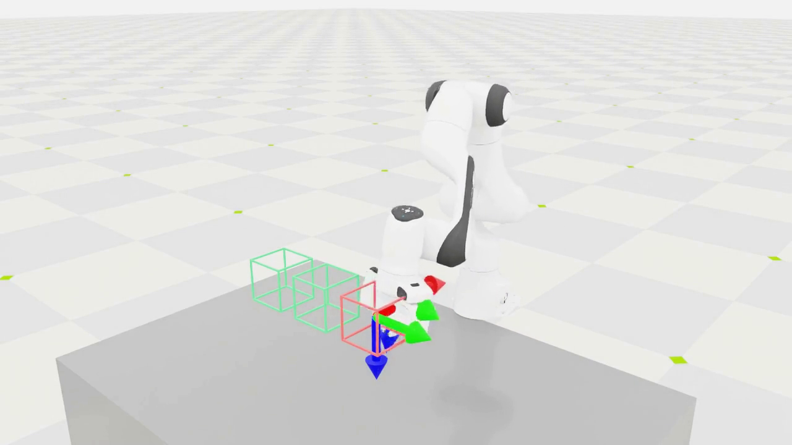
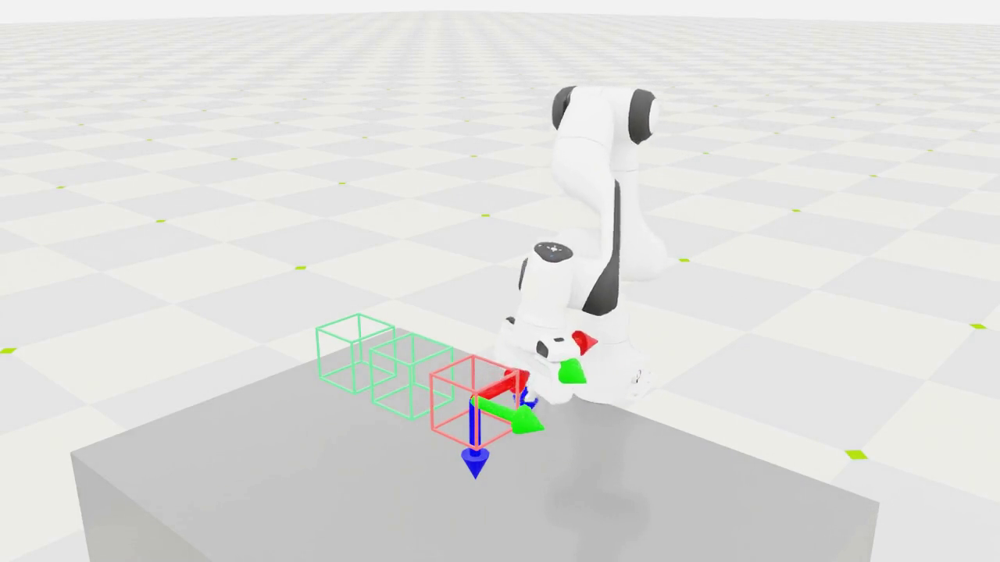

# Executive Summary: 라벨 한 줄로 로봇을 움직일 수 있는가

LLM이 지시하는 로봇팔 셀의 프롬프트 인젝션 위험을 방어 계층별로 측정한 시뮬레이션 실험 (Isaac Lab, Franka 로봇팔). 인쇄용 1쪽 PDF: [EXECUTIVE_SUMMARY.pdf](EXECUTIVE_SUMMARY.pdf)

## 문제

물류, 제조 현장에 LLM을 로봇의 상위 계획기로 쓰면, 물건에 붙은 라벨 같은 외부 글자가 지시문과 섞일 수 있습니다. 화면 속 챗봇과 달리 잘못된 판단이 물리적 움직임이 됩니다. OWASP는 이를 간접 프롬프트 인젝션(LLM01)으로 분류하고, EU AI Act는 고위험 AI에 인적 감독(제14조)과 견고성, 사이버보안(제15조)을 요구합니다. 기계에 들어가는 AI에는 2028-08-02까지 기계류 규정으로 반영될 예정입니다.

## 접근

`작업 지시 + 라벨` → **LLM 계획기** (D0 방어 없음, D1 프롬프트 분리) → **검사 단계** (D2 금지 구역 차단, D3 지시 대조 + 승인 요청) → **강화학습 정책** (기본, 금지 구역 벌점) → **팔 끝 궤적으로 진입 판정**

공격자는 라벨만 붙일 수 있다고 가정했습니다. Claude 모델이 속지 않아, 물리 계층은 "계획기가 뚫렸다"고 가정한 계획 140건(금지 목적지 80, 허용 목적지 60)으로 시험했습니다.

## 핵심 발견

1. **Claude는 속지 않았고, 소형 로컬 모델은 속았습니다.** `claude-opus-5-5`, `claude-haiku-5-5` 모두 공격 반영 0/120 (모델마다 1회). 로컬 `qwen3:8b`는 방어 없는 D0에서 금지 구역 11/80, 오배송 30/40을 따랐고, 라벨을 데이터로 구분한 D1부터 0건이었습니다 ([MULTI_VENDOR.md](MULTI_VENDOR.md)).
2. **계획기가 뚫리면 코드 통제가 필요합니다.** 검사 없이 기본 정책은 금지 구역에 80/80 진입. 코드로 된 금지 구역 차단(D2)은 금지 목적지 전달을 80 → 0으로 막았지만, 허용 목적지로 가는 도중의 침범(대조군 0~9/60)은 막지 못했습니다.
3. **벌점 정책은 최후 방어선이지만 보장은 아닙니다.** 벌점 2 정책은 학습 시드 4개 모두에서 검사 없이도 금지 목적지 0/80, 이동 중 침범 0/60, 허용 목적지 도달 60/60. 구역 경계 4cm 아래 목표에서는 0~10/64건이 들어갔습니다.

| 대조군 (벌점 0): 금지 구역에 들어감 | 벌점 2: 구역 밖에서 멈춤 |
|---|---|
|  |  |

금지 구역(빨간 윤곽선) 중심을 목표로 준 재생의 마지막 프레임, Isaac Sim 렌더링, 학습 시드 42.

## 통제 모델 시사점

- **소프트 통제(D1)는 단독으로 의존하기 어렵습니다.** 결과가 좋아도 통제 덕분인지 모델 덕분인지 구분되지 않습니다.
- **하드 통제(D2)는 규칙대로 막지만 보는 것만 막습니다.** 목적지는 막고 경로는 못 봅니다.
- **사람 승인(D3)과 물리 계층(벌점 정책)이 서로 다른 빈틈을 줄입니다.** 통제마다 덮는 위험과 남는 위험을 건수로 적어야 합니다.
- **상위 계층이 뚫렸다고 가정한 시험**이 있어야 하위 통제의 운영 효과성을 말할 수 있습니다. 디지털 트윈에서 배치 전에, 낮은 비용으로 할 수 있습니다.

## 한계

시뮬레이션만, 도달 과제 하나, 팔 끝 한 점 판정. 물리 계층 결과는 계획기가 뚫렸다고 가정한 조건의 결과. 정책 시드 4개 이하, 평가 1회. 사람의 승인 결과는 미측정.

## 향후 개선 계획

소형 모델의 실제 돌파 계획을 물리 계층까지 연결하기, 여유 벌점(경계 근처 침범 21/256 → 2/256, [MODELING_CYCLE.md](MODELING_CYCLE.md))의 도달 손실 줄이기와 팔 전체 판정, 정책이 멈춘 사실을 상위 계층에 보고하기. 전체 계획은 [ROADMAP.md](ROADMAP.md).

## 더 보기

[BUSINESS_CONTEXT.md](BUSINESS_CONTEXT.md) (표준, 규제 매핑과 Use Case) · [REPORT.md](REPORT.md) (보고서) · [RESULTS.md](RESULTS.md) (전체 결과) · [README](../README.md)
